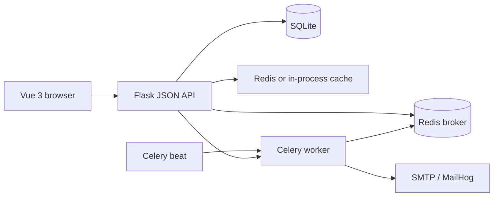
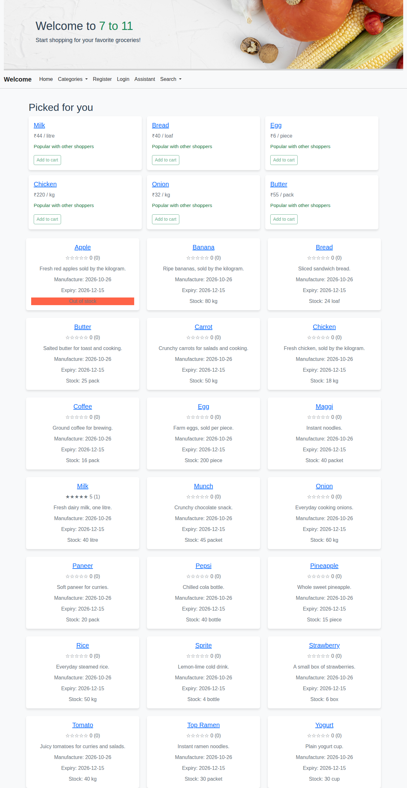
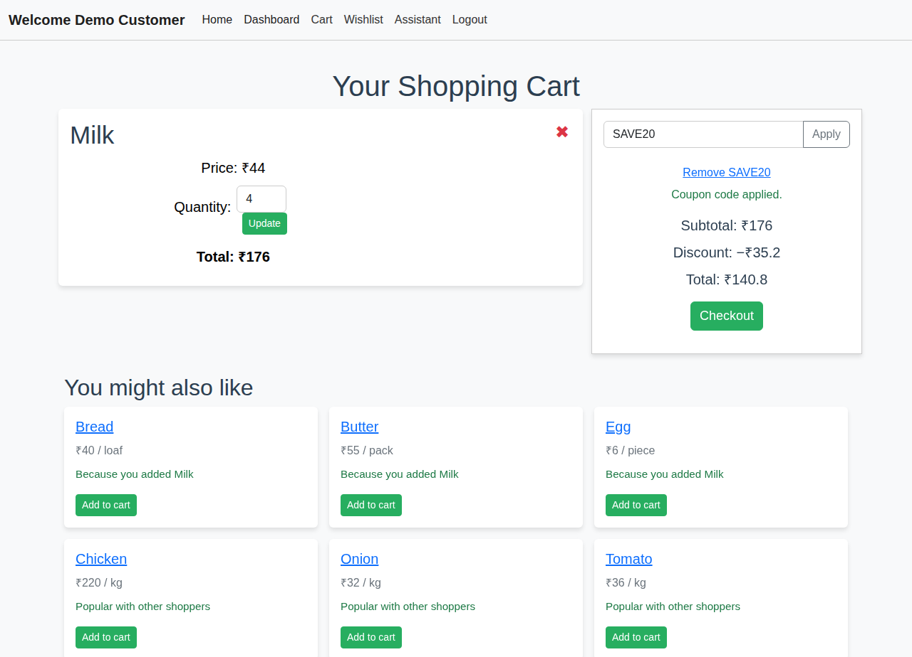
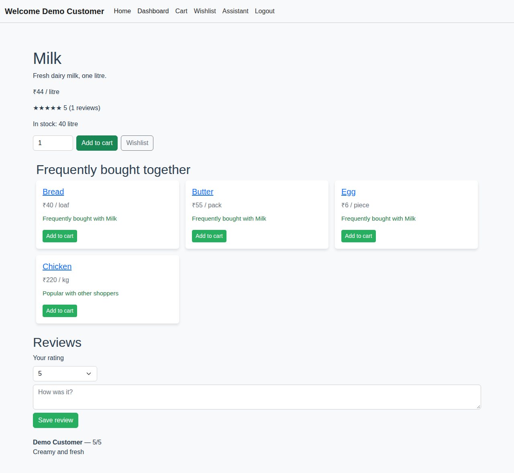
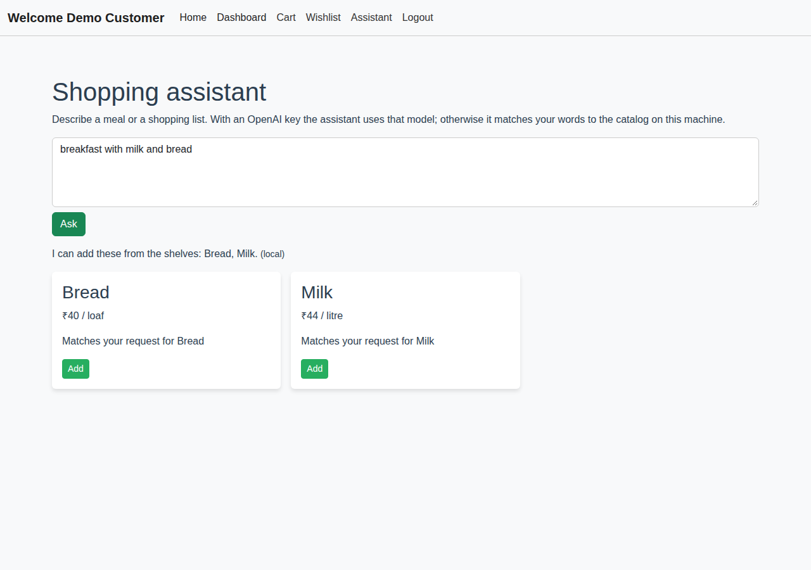
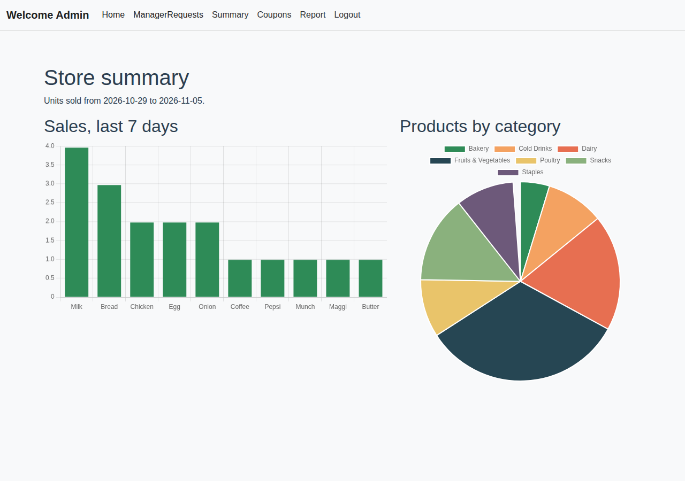
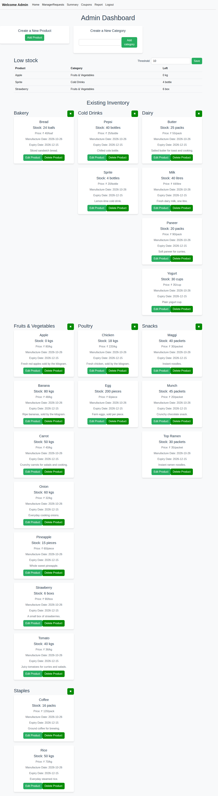
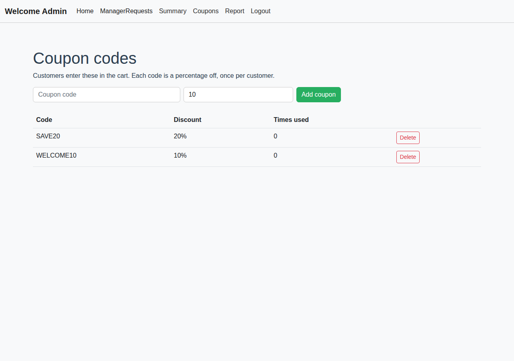

# Online Grocery Store

A portfolio build of a small online grocery: customers browse a catalog, fill a cart, apply a coupon, and check out; store managers keep the shelves stocked, watch low inventory, and read sales charts. It merges two earlier projects by Dripto Bhattacharyya:

- **Version 1** — server-rendered Flask and Jinja, raw `sqlite3`: [online-grocery-store](https://github.com/driptobhattacharyya/online-grocery-store). Coupons, the manager summary charts, and the cart discount behaviour come from here.
- **Version 2** — this repository's original API and Vue 3 frontend: JWT login, Redis caching, Celery beat for the daily reminder and the monthly report, and the store-manager approval flow.

Version 2 is the base. Version 1's behaviour was ported onto the JSON API instead of keeping a second server-rendered UI.

## Features

- Customer signup and login, with a separate admin login. Roles live in the database and in the JWT, not in a query parameter.
- Catalog by category, classic filters, and a **natural-language search** ("cheap milk under 50").
- Product pages with **1–5 star reviews** from customers who have bought the item, and the average on every card.
- **Wishlist**, including move-to-cart.
- Cart with quantity updates, a **percentage coupon** (validated on the server, consumed at checkout), and a total the browser cannot override.
- **You might also like** suggestions while the cart has items, plus a "picked for you" row on the home page.
- **Shopping assistant**: paste a recipe or a list and match it to products that can be added to the cart.
- Store-manager applications that an admin approves or rejects.
- Manager tools: products, categories, coupons (list, add, delete), a **summary page with bar and pie charts**, and a **low-stock** list with a threshold.
- Celery: daily reminder, monthly spend report, a daily low-stock email to managers, and an **asynchronous sales CSV**.
- AI calls are optional. With no `OPENAI_API_KEY` the same endpoints run on a local parser and TF-IDF.

## Architecture



The browser talks only to `/api`. Public catalog responses may be cached. Carts, dashboards, and manager actions are not cached, because a cache key of the URL alone would show one customer another customer's cart. Checkout, coupons, and stock changes all run in one database transaction and use the signed-in email from the token.

## Tech stack

| Layer | Choice |
| --- | --- |
| API | Flask, Flask-JWT-Extended, Flask-Cors |
| UI | Vue 3, Vue Router, Bootstrap 5, Chart.js |
| Data | SQLite, created by `applications/schema.py` |
| Cache | Flask-Caching. Redis when it is reachable, otherwise an in-process cache |
| Jobs | Celery and Redis. Beat sends the scheduled mail |
| Mail | SMTP. MailHog in Docker, so nothing real is sent |
| Search | Optional OpenAI-compatible chat and embeddings. Local TF-IDF otherwise |
| Tests | pytest and the Flask test client |

## Recommendation engine

The code is `applications/recommendations.py`. The cart page calls `GET /api/recommendations/cart`. The same function also powers "frequently bought together" on a product page and "picked for you" on the home page.

**Data.** `orders` and `order_items` (product id, order id, buyer email) are the purchase history. The anchors are the product ids in the current cart. `inventory` drops anything with no stock, and anything already in the cart is dropped too.

**Co-purchase (item-based).** Each product is the set of orders that contain it. Similarity of an anchor `c` and a candidate `p` is

`|orders containing both| / |orders containing c|`

The candidate's item score is the sum of that similarity over every anchor in the cart. The anchor with the biggest raw overlap is remembered so the card can say "Because you added Milk".

**Similar shoppers.** Other customers who bought at least one anchor are neighbours. A neighbour who shares `k` of the cart's products adds `k` to every other product they bought. That is the collaborative-filtering half: people with a similar basket vote for the rest of what they purchased.

**Blend.** Each score is divided by its own maximum, then combined as `0.6 * co-purchase + 0.4 * similar shoppers`. The higher weight is on co-purchase because that reason is the one a shopper can check by eye.

**Fallback.** If the cart is empty, or nobody has bought the cart's products with anything else, the list is filled by popularity (how many order lines contain the product) and labelled "Popular with other shoppers". With no orders at all, any in-stock product is used the same way.

On a product page the reason reads "Frequently bought with {name}". On the home page, for a signed-in customer, the anchors are products they have bought before, and the reason reads "Because you bought {name}".

## Ratings, wishlist, and low stock

- **Reviews** (`applications/ratings.py`). `POST /api/products/<id>/reviews` with a rating from 1 to 5. The customer must have an order line for that product. One row per customer per product; saving again updates it. Cards and the product page show the average and the count.
- **Wishlist** (`applications/wishlist.py`). Add, list, remove, and `POST /api/wishlist/<id>/move-to-cart`, which adds the item and then removes the wish.
- **Low stock** (`applications/inventory_alerts.py`). A threshold in `app_settings` (default 10) is editable from the manager dashboard. Products at or below it are listed there. Celery beat runs `low_stock_alert` every morning at 08:00 Asia/Kolkata and emails every admin and manager. Mail failures are logged and do not crash the worker.

## Search and the assistant

`applications/ai_service.py` is the only place that talks to a model.

- If `OPENAI_API_KEY` is set, a chat call turns the sentence into `{keywords, min_price, max_price}`. Embeddings then rank the catalog, unless `OPENAI_USE_EMBEDDINGS=0`, in which case TF-IDF ranks the model's keywords. A timeout or a bad response falls back to the local path.
- With no key, a small parser reads phrases such as "under 50" and "cheap" (cheap means a ceiling of ₹50). Remaining words are ranked with TF-IDF over the name, category, description, and unit, plus a bonus when the word is in the product name.
- The assistant does the same split. The model is asked to pick names from the catalog. Locally, product names and a few synonyms (`eggs` → Egg, `noodles` → Maggi) are matched against the message.

Every response includes `"provider": "openai"` or `"provider": "local"`.

## Coupons and checkout

Managers create a code and a percentage at `/manager/coupons` (`GET/POST/DELETE /api/manager/coupons`). A customer applies it from the cart. The code is stored against that cart and is **not** marked used until checkout commits. The server recomputes `subtotal`, the discount, and the total from database prices. A `totalPrice` field in the checkout body is ignored. Stock is reduced only for `cart.email = <the token's email>`. Using the same code again, after a successful order, is rejected.

## Project structure

```
app.py                         Flask app, CORS, JWT, Celery beat schedule
applications/schema.py         Tables and the demo seed
applications/catalog.py        Products, categories, classic search
applications/cart_functions.py Cart, coupon quote, checkout
applications/recommendations.py  Cart recommendations
applications/ai_service.py     Smart search and the assistant
applications/ratings.py        Reviews
applications/wishlist.py       Wishlist
applications/inventory_alerts.py Low-stock threshold and email body
applications/manager_summary_functions.py  Chart series as JSON
applications/backend_tasks.py  Celery tasks, including the sales CSV
applications/security.py       Password hashes and role checks
frontend/src                   Vue 3 storefront and manager pages
tests/                         pytest
docker-compose.yml             API, worker, beat, Redis, MailHog, nginx UI
```

## Run it locally

Python 3.12 and Node 18+ are enough. Redis is optional; without it the cache stays in the process and Celery jobs need the eager flag below, or a Redis you start yourself.

```bash
python3 -m venv .venv
source .venv/bin/activate
pip install -r requirements.txt
cp .env.example .env
python3 -m applications.schema
python3 app.py
```

In another terminal:

```bash
cd frontend
npm install
npm run serve
```

Open http://localhost:8080. The dev server proxies `/api` to http://localhost:5000.

### Demo accounts

| Who | Email | Password | Also accepted |
| --- | --- | --- | --- |
| Admin | admin@grocery.local | admin123 | username `admin` on the admin login page |
| Manager | manager@grocery.local | manager123 | ordinary login |
| Customer | customer@grocery.local | customer123 | ordinary login |

The customer has already bought milk and bread, so a review can be saved immediately. `WELCOME10` and `SAVE20` are seeded coupons. Sprite and strawberries start under the low-stock threshold. Apples are out of stock on purpose.

Change the passwords in `.env` before you seed if this database will be shared. They are hashed with PBKDF2 before they are stored. There is no committed database file.

### Mail and Celery

With Redis on `localhost:6379` and MailHog on SMTP `1025`:

```bash
celery -A app.celery_app worker --loglevel=INFO
celery -A app.celery_app beat --loglevel=INFO
```

MailHog's inbox is http://localhost:8025. The sales report button queues a task and downloads the CSV when the worker finishes. Set `CELERY_TASK_ALWAYS_EAGER=true` only when you want the task to run inside the API process.

Scheduled jobs, Asia/Kolkata:

- 18:00 daily reminder to customers
- 08:00 low-stock mail to managers and the admin
- 09:00 on the 1st, the monthly spend report

### Docker

```bash
docker compose up --build
```

The UI is http://localhost:8080, the API is http://localhost:5000, and MailHog is http://localhost:8025. Put a real `OPENAI_API_KEY` in a `.env` file next to `docker-compose.yml` if you want the hosted model; Compose picks it up for the API. The stack still runs with the variable empty.

### Tests

```bash
python3 -m pytest
```

The tests cover signup hashing, JWT expiry, role checks (including a forged `is_manager=true`), separate carts, checkout stock for one user only, coupon maths and reuse, the recommendation ranking and the cold-start fallback, reviews, the wishlist, low stock, the summary series, the async CSV, and smart search with no API key.

## Screenshots

Taken from a local run of the seeded store, with no API key.















## Credits

Built from Dripto Bhattacharyya's version 1 ([online-grocery-store](https://github.com/driptobhattacharyya/online-grocery-store)) and version 2 (the Flask JSON API and Vue 3 app this repository started as). The unified work keeps version 2's roles, mail jobs, and single-page UI, and brings across version 1's coupons and summary.
